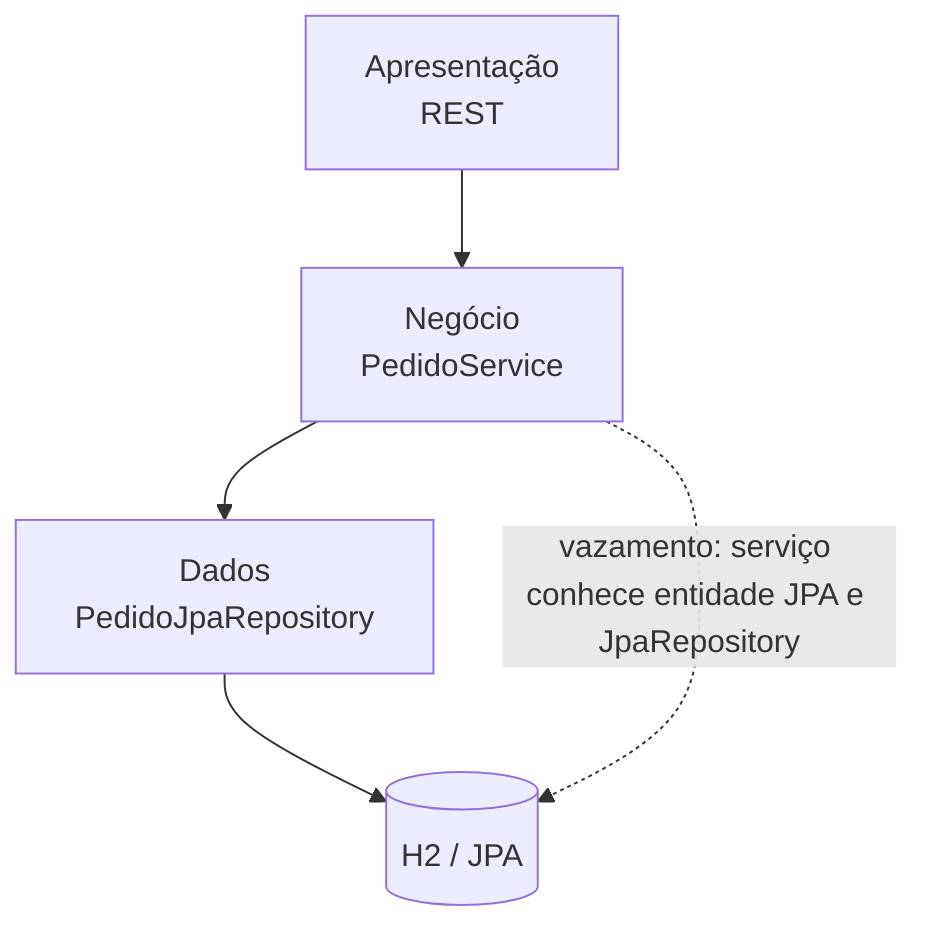
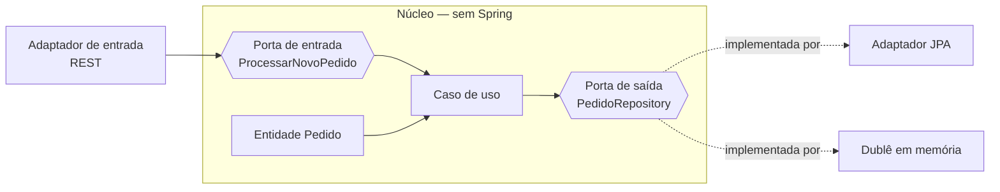
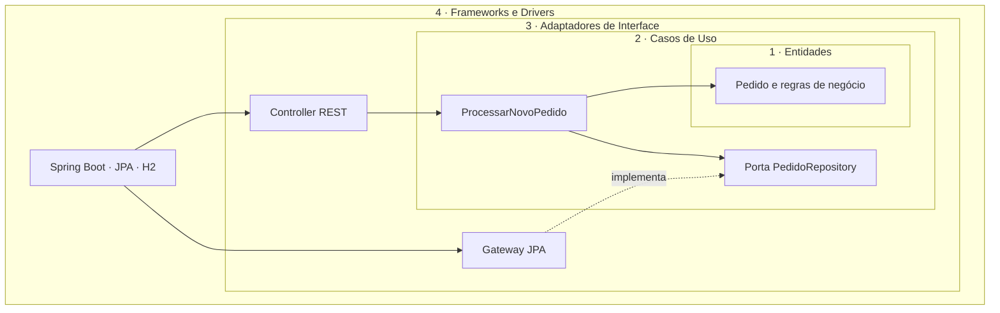

# Unidade 2 · Aula 4 — Arquiteturas em Camadas, Hexagonal e Clean

Projeto didático em **Java 21, Spring Boot 3 e Maven** que implementa o mesmo caso de uso — **processar um novo pedido** — em três estilos arquiteturais. Os diagramas destacam quem depende de quem; os testes exercitam os casos de uso com adaptadores em memória, sem banco real.

Fonte do conteúdo: **Unidade 2 · Aula 4 — Prof. Nataniel Paiva**.

## Comece aqui

```bash
mvn test
```

Para iniciar qualquer exemplo:

```bash
mvn -pl exemplos/camadas spring-boot:run
mvn -pl exemplos/hexagonal spring-boot:run
mvn -pl exemplos/clean spring-boot:run
```

Cada aplicação disponibiliza `POST /pedidos` com JSON `{"descricao":"Livro","valor":49.90}`. A resposta contém o identificador, descrição, valor e status `PROCESSADO`. Os exemplos usam H2 em memória para execução local; os testes de unidade usam dublês.

## Visão comparativa

| Estilo | Direção principal das dependências | Isolamento | Complexidade | Adequado para |
|---|---|---|---|---|
| [Camadas](docs/01-camadas.md) | Apresentação → negócio → dados | Baixo a moderado | Baixa | Sistemas pequenos/médios, regras simples e prazos curtos |
| [Hexagonal](docs/02-hexagonal.md) | Adaptadores → núcleo; núcleo define portas | Alto | Moderada | Testabilidade forte e infraestrutura substituível |
| [Clean Architecture](docs/03-clean-architecture.md) | Sempre para dentro | Muito alto | Alta | Sistemas longevos, regras complexas e mudanças tecnológicas previstas |

### Camadas clássicas: o vazamento de persistência



### Hexagonal: núcleo, portas e adaptadores



### Clean Architecture: dependências apontam para dentro



## Estrutura

```text
exemplos/
├── camadas/       # presentation → business → data; persistência vaza ao serviço
├── hexagonal/     # domain/application com portas; adapters.in e adapters.out
└── clean/         # entities → usecases → adapters → frameworks
docs/              # explicações, tradeoffs e decisão
adr/               # ADR-001: escolha arquitetural
diagramas/         # fontes Mermaid (.mmd)
```

## Regra de dependência e testes

- **Camadas:** o serviço de negócio usa diretamente `PedidoEntity` e `PedidoJpaRepository`, tornando visível o acoplamento de persistência do estilo clássico.
- **Hexagonal:** o núcleo declara portas de entrada/saída; adaptadores concretos implementam as portas. ArchUnit impede imports de Spring e JPA no domínio e na aplicação.
- **Clean:** entidades e casos de uso são Java puro; `@Configuration` na camada externa faz a composição. ArchUnit impede imports de Spring e JPA em `entities` e `usecases`.
- Cada módulo possui teste do fluxo com dublê em memória e teste ArchUnit para a regra de dependência especificada.

Ver [como escolher](docs/05-escolhendo-o-estilo.md), [tradeoffs](docs/04-comparacao-e-tradeoffs.md) e a [decisão registrada](adr/ADR-001-estilo-arquitetural.md).
