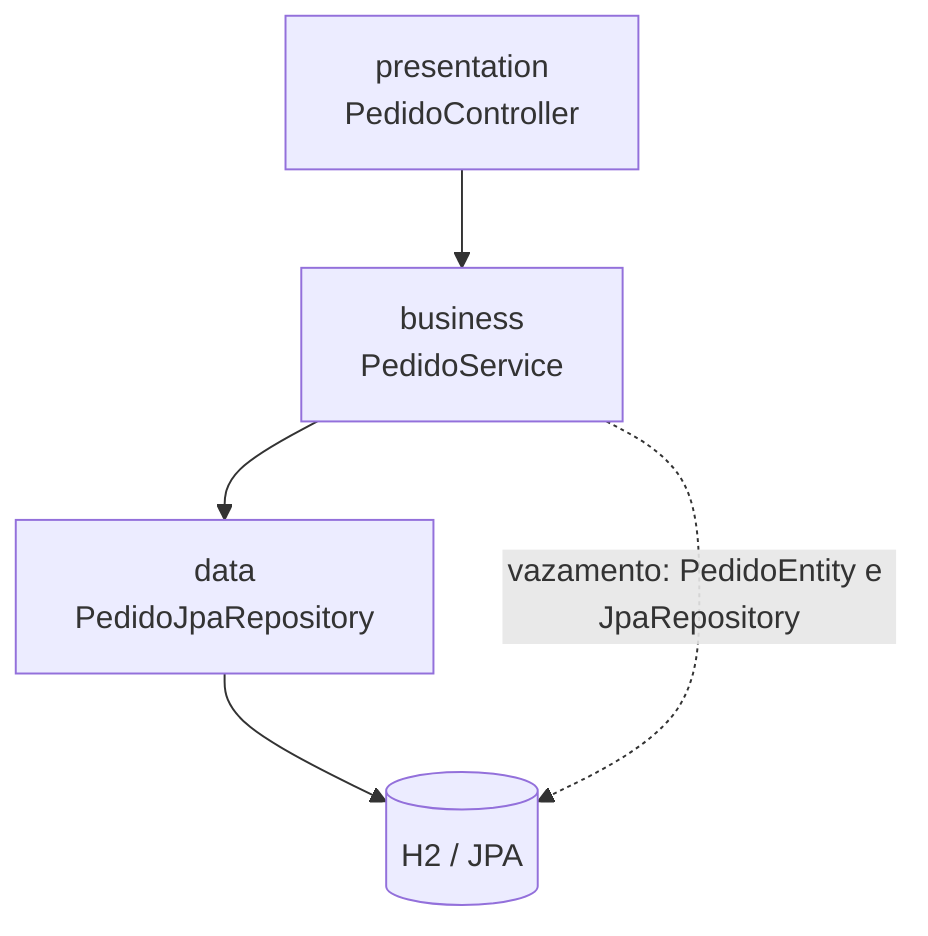

# Arquitetura em camadas

**Exemplo adicional:** o módulo `exemplos/camadas` implementa `POST /pedidos` por meio de apresentação (`@RestController`), negócio (`@Service`) e dados (`JpaRepository`).



## Dependências e tradeoff

A regra didática é cada camada depender somente da camada imediatamente abaixo: apresentação → negócio → dados. A separação facilita a compreensão e permite substituir a dependência inferior por dublês nos testes. Neste exemplo, porém, o serviço recebe e persiste uma entidade JPA via `JpaRepository`; a lógica de negócio fica acoplada à tecnologia de dados, o “bolo de lasanha”.

É uma opção simples e de baixa complexidade para sistemas pequenos e médios com regras não excepcionalmente complexas. A troca de persistência e testes sem infraestrutura tornam-se mais difíceis quando o acoplamento cresce.

## Estrutura

```text
br/com/aula/camadas/
├── presentation/  # HTTP e DTOs
├── business/      # serviço que expõe o vazamento
└── data/          # entidade JPA e Spring Data
```
