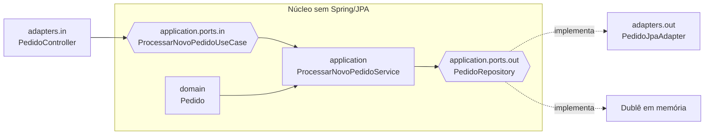

# Arquitetura hexagonal — Ports and Adapters

**Exemplo adicional:** `exemplos/hexagonal` mantém `domain` e `application` independentes do framework. O núcleo define a porta de entrada `ProcessarNovoPedidoUseCase` e a porta de saída `PedidoRepository`; o adaptador REST traduz HTTP e o adaptador JPA implementa persistência.



Porta é uma interface definida pelo núcleo: de entrada descreve o que a aplicação oferece; de saída, o que ela precisa. Adaptadores concretos conectam HTTP, banco ou teste a essas interfaces. O núcleo conhece somente as portas — uma aplicação do DIP em escala arquitetural.

```text
br/com/aula/hexagonal/
├── domain/
├── application/ports/{in,out}/
└── adapters/{in,out}/
```

Teste-se o serviço de aplicação com uma implementação em memória da porta de saída. ArchUnit protege o núcleo contra dependências Spring/JPA.
