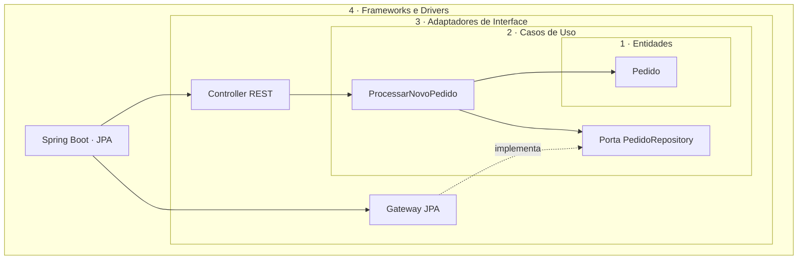

# Clean Architecture

**Exemplo adicional:** `exemplos/clean` organiza o código em quatro camadas concêntricas. A regra é que as dependências de código-fonte apontam apenas para dentro.

| Camada | Responsabilidade |
|---|---|
| Entidades | Regras de negócio gerais e estáveis |
| Casos de Uso | Orquestração do fluxo específico da aplicação |
| Adaptadores de Interface | Conversão de dados de/para agentes externos |
| Frameworks e Drivers | Spring, banco e bibliotecas externas |

Entidades e casos de uso não importam Spring nem JPA. A aplicação externa monta as implementações com `@Configuration` e `@Bean`; a porta de persistência é definida no núcleo e implementada no gateway externo. A separação maximiza isolamento e testabilidade, ao custo de mais interfaces, conversores e código de composição. ArchUnit verifica a independência das duas camadas internas.
