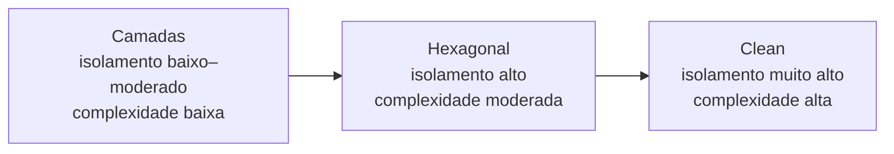

# Comparação e tradeoffs

| Estilo | Rigor de isolamento | Complexidade de adoção | Cenário mais adequado |
|---|---|---|---|
| Camadas clássicas | Baixo a moderado | Baixa | Sistemas pequenos a médios, equipes iniciantes e prazos curtos |
| Hexagonal | Alto | Moderada | Forte necessidade de testabilidade e troca de infraestrutura |
| Clean Architecture | Muito alto | Alta | Sistemas longevos, regras complexas e mudanças tecnológicas previstas |

Mais isolamento requer maior disciplina e código de ligação. Camadas são diretas, mas podem propagar detalhes de persistência para o negócio. Hexagonal inverte essa dependência com portas e adaptadores. Clean formaliza a direção para dentro em quatro camadas e pode gerar código de composição excessivo em funcionalidades simples.

Comparar os exemplos pelo mesmo fluxo evita atribuir ao estilo diferenças que vêm do próprio caso de uso. Os testes usam dublês em todos os módulos; os testes ArchUnit protegem as fronteiras exigidas em hexagonal e clean.
