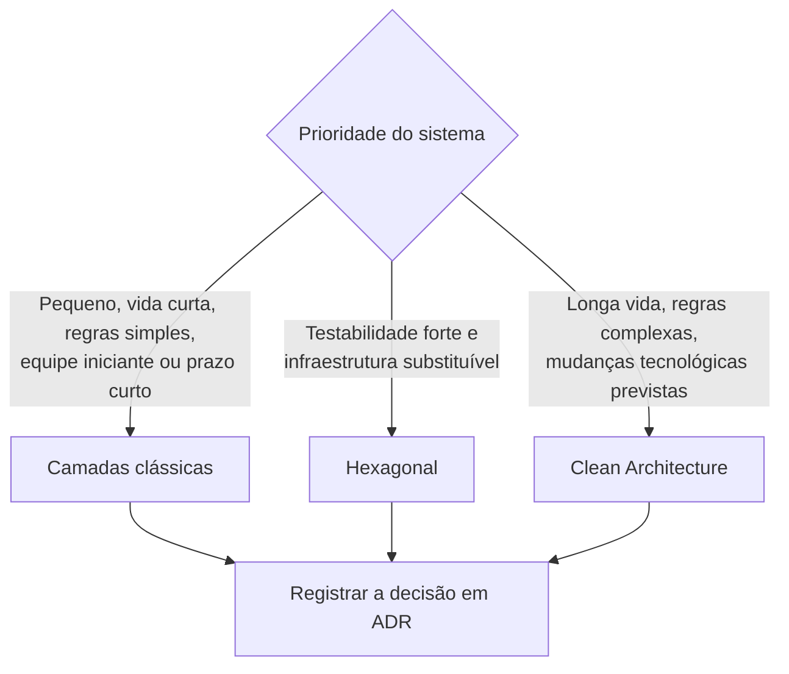

# Como escolher

A escolha deve refletir atributos de qualidade prioritários e custo de reversão, não popularidade. Um sistema pequeno, de vida curta e regras simples tende a se beneficiar de camadas. Quando as regras duram mais que a infraestrutura, hexagonal ou Clean ajudam a manter o núcleo independente. Registre a escolha porque o estilo é uma decisão arquiteturalmente significativa e cara de reverter.

Consulte [ADR-001](../adr/ADR-001-estilo-arquitetural.md), que registra a escolha de Clean Architecture para este projeto didático.
