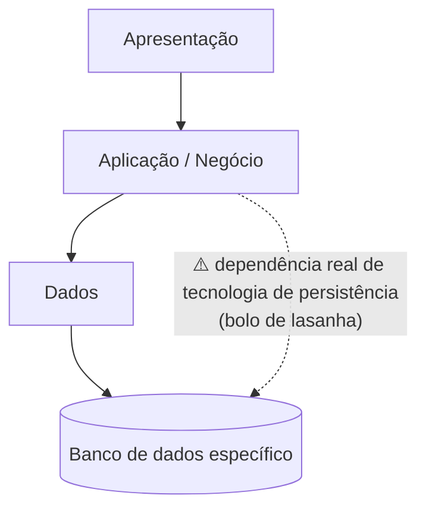
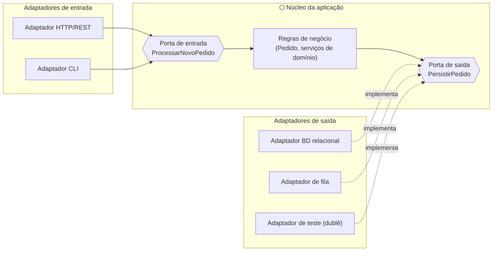
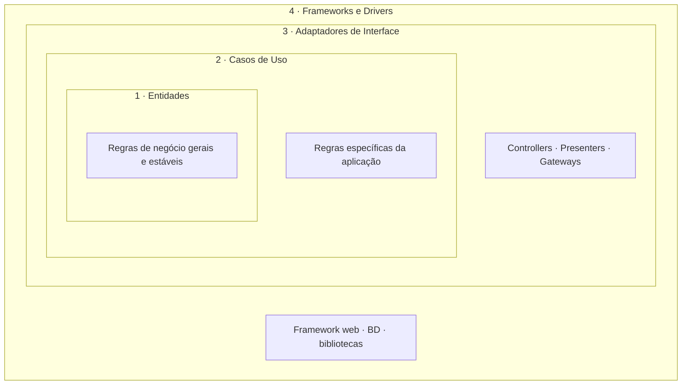
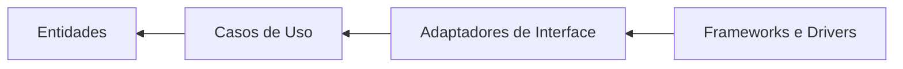
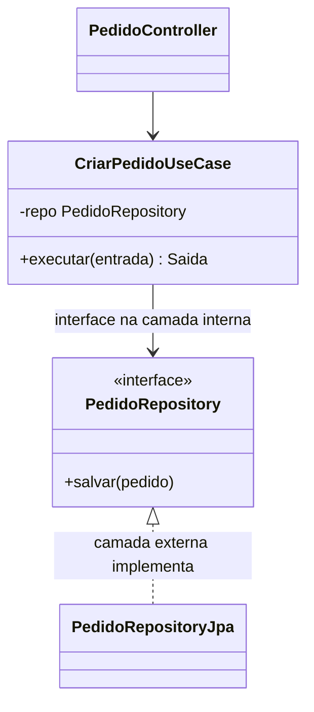
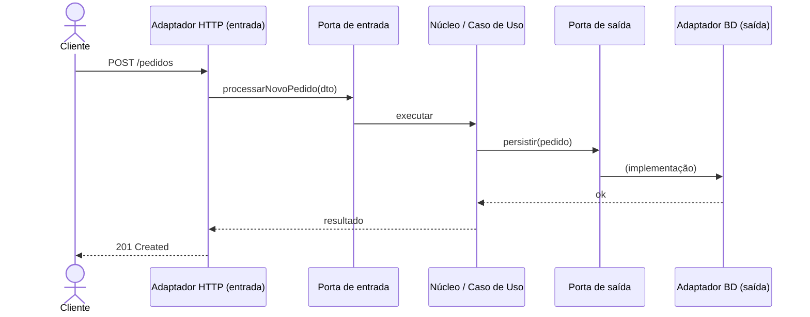
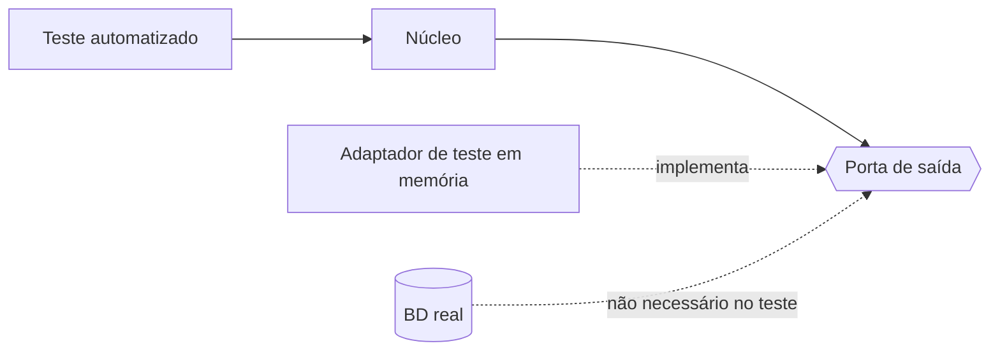
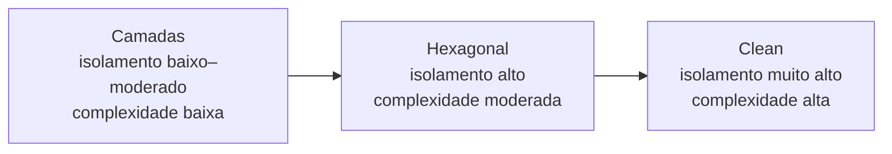
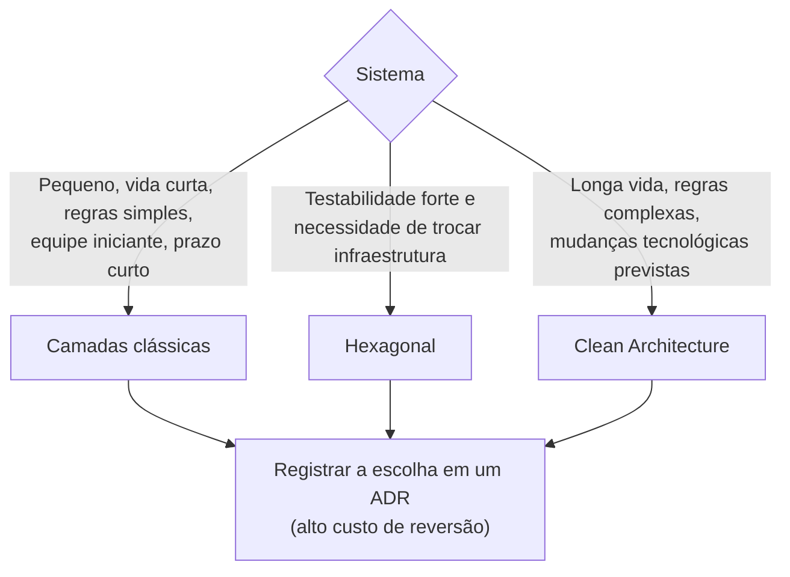

# Unidade 2 · Aula 4 — Arquiteturas em Camadas, Hexagonal e Limpa: Princípios e Tradeoffs

> **Curso:** Arquitetura de Sistemas e Microsserviços · **Unidade 2 · Aula 4** · Prof. Nataniel Paiva
> **Fonte:** `Aula4_..._Arquiteturas em Camadas, Hexagonal e Limpa Princípios e Tradeoffs_unidade02_aula04.pptx` (35 slides)

Este README é um **briefing para outra IA** criar um projeto visual que compare os três estilos arquiteturais. Conteúdo extraído dos slides; diagramas Mermaid são **exemplos prontos** para o GitHub.

---

## 1. Objetivo do projeto a ser gerado

Implementar (ou ao menos modelar) **o mesmo caso de uso** nos três estilos — **Camadas, Hexagonal e Clean** — com diagramas de estrutura, regra de dependência, estrutura de pastas e comparação de tradeoffs. Sugestão de caso: *"processar novo pedido"* (os slides citam "persistir um pedido" e "processar um novo pedido").

**Idioma:** PT-BR. **Tom:** comparativo, com diagramas lado a lado.

### 1.1 Stack de código (obrigatória)

> **Todo código do projeto DEVE ser em Java com Spring.** Não gerar exemplos em outras linguagens.

- **Java 21 (LTS)** + **Spring Boot 3.x** · **Maven** · **JUnit 5** + Mockito · **ArchUnit** para **testar automaticamente a regra de dependência**.
- Implementar o **mesmo caso de uso ("processar novo pedido")** em três módulos Maven (ou três pacotes raiz): `camadas`, `hexagonal`, `clean`.
  - **Camadas:** `presentation` (`@RestController`), `business` (`@Service`), `data` (`@Repository`/Spring Data) — mostrar o **vazamento** (o serviço usando a entidade JPA/`JpaRepository` diretamente).
  - **Hexagonal:** `domain` + `application` com **portas** (`interface`s `in`/`out` definidas pelo núcleo); `adapters.in` (`@RestController`) e `adapters.out` (`@Repository` implementando a porta). O núcleo **não depende de Spring Data/JPA**.
  - **Clean:** `entities`, `usecases`, `adapters` (controllers/presenters/gateways), `frameworks` (Spring Boot, JPA). **Entidades e Casos de Uso sem imports do Spring** — a ligação (`@Configuration` com `@Bean`) fica na camada externa.
- **Testes:** teste do núcleo/caso de uso com **adaptador de teste em memória (dublê)**, sem banco real; teste ArchUnit falhando se uma camada interna importar `org.springframework.*`/`jakarta.persistence.*` (hexagonal e clean).
- Documentar a escolha do estilo em **ADR** (Markdown) conforme os slides.

## 2. Resumo do conteúdo (fonte de verdade)

### 2.1 Arquitetura em camadas
- Camadas **horizontais empilhadas**: **apresentação → aplicação/negócio → dados**; cada camada só fala com a **imediatamente abaixo**.
- **Regra:** depende só da camada abaixo, nunca da acima. Facilita compreensão e testes (com dublês da camada inferior).
- **Vantagem:** simplicidade conceitual; bom para sistemas **pequenos a médios** com regras não excepcionalmente complexas.
- **Limitação:** a camada de negócio tende a depender de **tecnologias de persistência específicas** → difícil trocar o banco e testar sem banco real; a dependência "para baixo" acopla a lógica a detalhes de infraestrutura. Chamada informalmente de **"arquitetura bolo de lasanha"** (camadas bem definidas, mas com vazamento entre elas).

### 2.2 Arquitetura hexagonal (Ports and Adapters) — Alistair Cockburn, 2005
- Resposta ao vazamento de infraestrutura para o negócio. **Núcleo da aplicação no centro**, isolado de tecnologia; ligado ao mundo externo (UI, banco, serviços externos, filas) **só por portas e adaptadores**.
- **Porta** = interface definida **pelo núcleo**: *de entrada* (o que o núcleo oferece, ex.: "processar um novo pedido") ou *de saída* (o que precisa, ex.: "persistir um pedido").
- **Adaptador** = implementação concreta da porta: *de saída* (ex.: persistência em BD relacional) ou *de entrada* (traduz requisição HTTP em chamada à porta de entrada).
- O núcleo **nunca conhece os adaptadores**, só as portas → **DIP em escala arquitetural**.
- **Testabilidade:** trocar adaptadores reais por **dublês**, sem BD/fila reais.

### 2.3 Clean Architecture — Robert C. Martin, 2012
- Generaliza a mesma ideia com **4 camadas concêntricas** e **uma regra:** dependências de código-fonte **só apontam para dentro**.
| Camada (de dentro para fora) | Conteúdo |
|---|---|
| **Entidades** | regras de negócio mais gerais e estáveis |
| **Casos de Uso** | orquestram o fluxo entre entidades; regras específicas da aplicação |
| **Adaptadores de Interface** | convertem dados entre o formato dos casos de uso/entidades e o de agentes externos (BD, UI) |
| **Frameworks e Drivers** | framework web, BD específico, bibliotecas de terceiros |
- Consequência: Entidades e Casos de Uso **não importam** framework web nem biblioteca de BD. Comunicação interna→externa por **interface definida na camada interna** (inversão de dependência).

### 2.4 Comparação (Tabela 2)
| Estilo | Rigor de isolamento | Complexidade de adoção | Cenário mais adequado |
|---|---|---|---|
| Camadas (clássica) | Baixo a moderado | Baixa | Sistemas pequenos a médios, equipes iniciantes, prazos curtos |
| Hexagonal | Alto | Moderada | Forte necessidade de testabilidade e de trocar infraestrutura |
| Clean Architecture | Muito alto | Alta | Sistemas de longa vida, regras complexas, mudanças tecnológicas previstas |

### 2.5 Como escolher
- Não pela popularidade; sim por **atributos de qualidade prioritários** e **custo de reversão**.
- Sistema **pequeno, vida curta, regras simples** → camadas. Sistema **longa vida, regras mudam menos que a infraestrutura** → hexagonal ou Clean.
- A escolha do estilo é **decisão arquiteturalmente significativa**, de alto custo de reversão → **registrar em ADR**.
- Custo da Clean: maior quantidade de código de composição (interfaces, conversores entre camadas) mesmo para funcionalidades simples.

---

## 3. Exemplos Mermaid (renderizam no GitHub)

### 3.1 Camadas clássicas e o "vazamento"



### 3.2 Hexagonal — núcleo, portas e adaptadores (Figura do slide 11)



### 3.3 Clean Architecture — camadas concêntricas (Figura do slide 22)



Regra da dependência (setas = quem conhece quem):



### 3.4 Inversão de dependência no Caso de Uso



### 3.5 Fluxo de uma requisição (sequência — *exemplo adicional*)



### 3.6 Testabilidade (dublê no lugar do adaptador real)



### 3.7 Comparativo visual dos estilos



### 3.8 Qual estilo escolher



### 3.9 Estruturas de pastas (exemplo adicional, em árvore)

```text
camadas/            hexagonal/              clean/
├─ presentation/    ├─ domain/              ├─ entities/
├─ business/        ├─ application/         ├─ usecases/
└─ data/            │   ├─ ports/in         ├─ adapters/ (controllers, gateways)
                    │   └─ ports/out        └─ frameworks/ (web, db)
                    └─ adapters/in|out
```

---

## 4. Estrutura sugerida do projeto a gerar

```
unidade2-aula4-projeto/
├── README.md                    # comparação + diagramas lado a lado
├── docs/
│   ├── 01-camadas.md
│   ├── 02-hexagonal.md
│   ├── 03-clean-architecture.md
│   ├── 04-comparacao-e-tradeoffs.md
│   └── 05-escolhendo-o-estilo.md
├── exemplos/
│   ├── camadas/   hexagonal/   clean/     # mesmo caso de uso nos 3 estilos
├── testes/                      # mesmo teste do núcleo com dublês de adaptador
├── adr/ADR-001-estilo-arquitetural.md
└── diagramas/                   # .mmd fonte
```

## 5. Regras para a IA que for gerar o projeto

1. **O mesmo caso de uso nos três estilos**, para o leitor comparar de verdade.
2. **Mostrar a regra de dependência** (setas) e o ponto onde o **DIP** aparece em cada estilo.
3. Evidenciar o **vazamento** do estilo em camadas e como hexagonal/clean o evitam.
4. Incluir **tabela de tradeoffs** e o **ADR** da escolha do estilo.
5. Código de exemplo marcado como *"exemplo adicional"*; demonstrar **testes com dublês**.
6. **Mermaid:** subgraphs aninhados para Clean; testar renderização.
7. Citar: *Unidade 2 · Aula 4 — Prof. Nataniel Paiva*.

## 6. Checklist de aceitação

- [ ] Diagramas dos 3 estilos, com a regra de dependência
- [ ] Portas de entrada/saída e adaptadores na hexagonal
- [ ] 4 camadas concêntricas na Clean, nomeadas
- [ ] Tabela de tradeoffs (Tabela 2) + árvore de decisão
- [ ] ADR da escolha do estilo
- [ ] Testes com dublês no lugar do banco real
